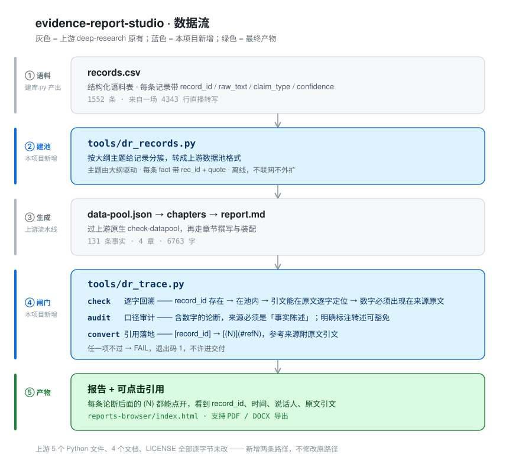
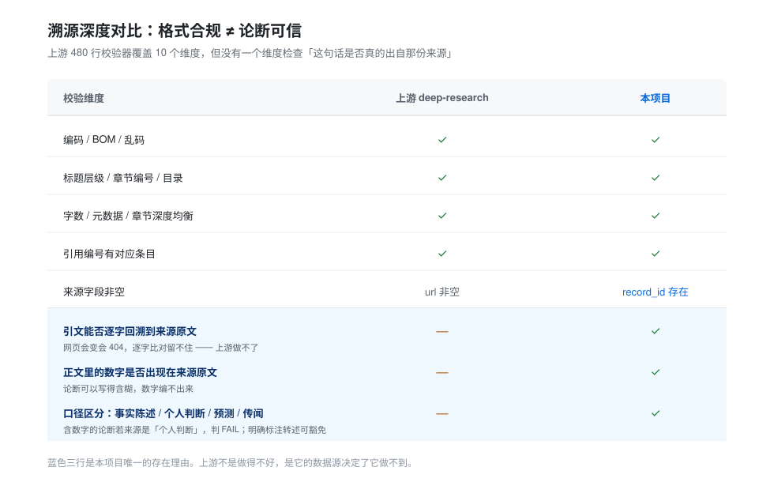

# evidence-report-studio

> 把「AI 写报告」从**看起来专业**，变成**不可能被编出来**。
>
> 基于 [hoolulu/deep-research](https://github.com/hoolulu/deep-research)（MIT）二次开发：保留它的四阶段流水线与报告浏览器，补上它做不到的那一环——**每条论断逐字回溯到原始语料记录**。



---

## 为什么值得改这一层

上游 `tools/dr_check.py` 有 480 行、10 个检查维度：编码、字数、JSON、标题层级、章节编号、元数据、目录、尾部、年份密度、数据池、深度均衡。

**没有一个维度检查「这句话是否真的出自那份来源」。** 它的溯源深度只有这一条：

```python
url_val = fact.get('url')
if not url_val or not str(url_val).strip():
    issues.append(f"Record {i} fact {j}: 'url' is empty or null")
```

只要求 URL 非空。

这不是偷懒，是**结构性限制**：它的数据源是网页，网页会变、会 404、会被改写，逐字比对做了也留不住，下次校验必然失败。所以只能退到"有个链接"。

而本地语料是**不可变的 CSV**。原文永远不变 → 逐字比对 100% 可做 → 这条护城河只有本地语料场景能挖。



---

## 与上游的差异

| | 上游 deep-research | 本项目 |
|---|---|---|
| 数据源 | 联网搜索 + 网页抓取 | **本地结构化语料表**（离线，不联网不外扩） |
| 引用单位 | `(机构, 年份, URL)` 三元组首次出现顺序编号 | **`record_id` 稳定 ID** |
| 溯源深度 | 来源字段非空 | **引文逐字回溯 + 数字落地 + 口径审计** |
| 校验失败后果 | 报告仍可交付 | **FAIL，退出码 1，不许进交付** |
| 上游代码 | — | **5 个 Python + 4 个文档 + LICENSE 逐字节未改** |

关于引用单位这一项，值得多说一句：上游按"首次出现顺序"编号，事实顺序一变，所有引用号整体错位，而且**没有任何机制能发现错位**。`7699100533977582374-0227` 永远指向同一条记录，不会错。

---

## 三道闸门

```bash
python tools/dr_trace.py check   --report r.md --pool data-pool.json --records records.csv
python tools/dr_trace.py audit   --report r.md --pool data-pool.json --records records.csv
python tools/dr_trace.py convert --report r.md --pool data-pool.json --records records.csv
```

**`check` — 逐字回溯**

| # | 校验 | 不通过的含义 |
|---|---|---|
| 1 | `record_id` 在语料表里存在 | 这个 ID 是编的 |
| 2 | `record_id` 在本次数据池里 | 越界引用（没检索到却引用了） |
| 3 | 该条 fact 的 `quote` 能在原文里**逐字定位** | 引文对不上原文 |
| 4 | **正文的量化数字必须出现在被引用记录的原文里** | 论断可以含糊，数字编不出来 |
| 5 | 引用密度 ≥30% 段落 | 大段在自由发挥 |

第 3 条定位时先精确找，找不到再去掉所有空白重找（模型常少写/多写空格），仍找不到才判 FAIL。

**`audit` — 口径审计**

含数字的论断，其引用来源必须是「事实陈述」。一条"去年投放 8500 万"如果是说话人自己的说法，引用它就是在把观点当数据用。

但**明确标注的转述豁免**：句子里有「他说」「据介绍」「他预计」「原话」这类标记，不算违规。允许转述，禁止把转述当客观事实——这就是「不虚构」的分界线。

**`convert` — 引用落地**

`[record_id]` 按正文首次出现顺序编号成 `[(N)](#refN)`，生成参考来源段：

```
(1) `7699100533977582374-0227` · 2026-10-21 23:30:01 · 嘉宾
    — 原文「他们卖2000块钱 一个月卖给经销商 一年平均要2万多 厂家给一半钱 经销商要出」
```

---

## 快速开始

```bash
# 0) 语料：由 douyin-living 的 建库.py 从直播转写产出
#    records.csv 需要这些列：
#    record_id / source_file / ts_start / speaker_id / speaker_role
#    raw_text / clean_text / segment_type / claim_type / confidence / topic

# 1) 看语料概况，分层抽样（给大纲用）
python tools/dr_records.py stats  --records records.csv
python tools/dr_records.py sample --records records.csv --n 160 --out sample.md

# 2) 写 outline.json（章节 + 子问题 + 关键词），然后按大纲建池
python tools/dr_records.py build --records records.csv \
    --outline outline.json --out data-pool.json
python tools/dr_tools.py check-datapool data-pool.json --mode standard

# 3) 写章节：chapters/chapter-N.md，论断行尾写 [record_id]

# 4) 装配
python tools/dr_tools.py assemble-report --outline outline.json \
    --chapters-dir chapters --datapool data-pool.json \
    --mode standard --target-year 2026 --output report.md

# 5) 过闸门 → 落地引用
python tools/dr_trace.py check   --report report.md --pool data-pool.json --records records.csv
python tools/dr_trace.py audit   --report report.md --pool data-pool.json --records records.csv
python tools/dr_trace.py convert --report report.md --pool data-pool.json --records records.csv

# 6) 报告浏览器（--local 才生成自包含版本）
python tools/generate_pages.py --local
```

`example/` 里有完整的一套中间产物（`outline.json` / `data-pool.json` / `chapters/` / `report.md`），可以直接对着看。

---

## 实测数据

2026-10-21 一场直播的转写语料，全链跑通：

| 环节 | 数值 |
|---|---|
| 输入语料 | 1552 条记录（4343 行转写） |
| 有效记录 | 1206（丢弃 346 条闲聊/附和/过短） |
| 大纲主题 | 8 个（4 章 × 2 节） |
| 入池事实 | 131 条（每条带 `rec_id` + `quote`） |
| 报告成品 | 269 行 / 6763 字 / 4 章 |
| 引用 | 51 处（去重 48），**逐字通过 48/48** |
| 段落覆盖 | 30/42 = 71% |
| 口径分布 | 事实陈述 76.5% / 个人判断 19.6% / 预测 3.9% |
| 校验结论 | `check` PASS · `audit` PASS · 上游 `assemble-report` PASS · 上游 `check-datapool` PASS |

### 校验器抓到的真实错误

首轮 4 个 FAIL，其中 3 个是真错——**是我自己写错的**：

| 类型 | 实例 |
|---|---|
| 引用错位 | 把「2.5 能生成 30 秒视频」引到了不含 2.5 的记录 |
| 引用错位 | 把「8 台方案」引到了只讲 B300 的记录 |
| 推断混入事实 | 正文写「疑似 1.6 亿」，原文只有「1 6 亿」 |
| 口径越界 | 把「至少能卖 100 个客户」当结论写，来源是预测 |

写报告的人和校验报告的人必须是两套逻辑，否则自查永远查不出来。

第 4 个是误报：`H3` / `B300` / `720P` 这类型号里的数字被当成"量"。已加判定——数字前后紧邻 ASCII 字母算标识符，纯 `x.y` 无单位算版本号。

---

## 已知限制

1. **主题匹配靠字符 bigram，不是语义**。大纲关键词与语料用词差异大时匹配不上（实测 1058 条未匹配，多数确实是噪音，但会漏）。
2. **中文数字量词不被审计**。「五折」「一万块」「三个月」不含阿拉伯数字，`audit` 检测不到。
3. **`audit` 的转述判定是关键词表**，不是语义判断，句子结构复杂时会漏判或误判。
4. **引用密度阈值 30% 是经验值**，不同文体要调。
5. **上游的 agent 编排层未接管**。本项目把数据源、校验、落地做成可独立运行的 CLI，但「大纲 agent / 章节 agent」那一层仍是上游 `SKILL.md` 的编排逻辑。
6. **上游 `prepare_chapter` 的中文匹配本身有 bug**（`sq.split()` 对中文返回整句，子串判断几乎永远为假）。本项目绕开了它——`dr_records.py` 自己做匹配。上游那处未修，因为要保持零改动。

---

## 目录

```
tools/
  dr_records.py     ← 新增：records 数据源
  dr_trace.py       ← 新增：check / audit / convert / quote
  dr_check.py       ← 上游，未改
  dr_gen.py         ← 上游，未改
  dr_tools.py       ← 上游，未改
  lang_config.py    ← 上游，未改
  generate_pages.py ← 上游，未改
docs/
  architecture.svg  ← 数据流
  trace-depth.svg   ← 溯源深度对比
example/            ← 一套完整中间产物，可对照复现
reports/zh/         ← 成品报告
reports-browser/    ← 报告浏览器（自包含，可离线打开）
TECHNICAL.md        ← 技术说明（改动边界、设计取舍、实测细节）
NOTICE              ← 上游归属与改动清单
```

---

## 许可与归属

上游 [hoolulu/deep-research](https://github.com/hoolulu/deep-research) 为 MIT License，Copyright (c) 2026 hoolulu。`LICENSE` 原文未改动，`README.md` 已改名 `UPSTREAM-README.md` 原样保留。

新增部分同样以 MIT 授权，版权声明见 `NOTICE`。
